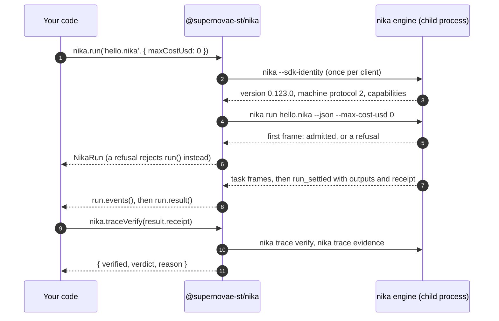

<p align="center">
  <a href="https://nika.sh">
    <picture>
      <source media="(prefers-color-scheme: dark)" srcset="https://nika.sh/brand/nika-logo-dark.svg">
      
    </picture>
  </a>
</p>

<h1 align="center">@supernovae-st/nika</h1>

<p align="center">
  <strong>Run AI workflows from your TypeScript app, and prove what they did.</strong><br>
  Checked before they start, typed when they finish, verifiable afterwards: the Nika engine ships inside the package.
</p>

<p align="center">
  <a href="https://www.npmjs.com/package/@supernovae-st/nika"></a>
  <a href="https://github.com/supernovae-st/nika-client/actions/workflows/ci.yml"></a>
  <a href="https://github.com/supernovae-st/nika/releases/latest"></a>
  <a href="https://docs.nika.sh"></a>
  <a href="LICENSE"></a>
  <br>
  <a href="https://scorecard.dev/viewer/?uri=github.com/supernovae-st/nika-client"></a>
  <a href="https://www.npmjs.com/package/@supernovae-st/nika"></a>
  <a href="https://www.npmjs.com/package/@supernovae-st/nika"></a>
  <a href="https://archive.softwareheritage.org/browse/origin/?origin_url=https://github.com/supernovae-st/nika-client"></a>
</p>

**Watch a Node app run this README's quick start: checked, run, typed, verified.**

<p align="center">
  <a href="https://raw.githubusercontent.com/supernovae-st/nika/v0.123.0/media/gifs/typescript-client.optimized.gif">
    
  </a>
</p>
<p align="center"><sub><code>demo.mts</code> from the quick start calls <code>run()</code>. The engine the package bundles checks <code>hello.nika</code>, runs it and records it; the result comes back typed, and <code>traceVerify()</code> prints <code>receipt verified</code>. Captured with <code>@supernovae-st/nika</code> 0.120.3 and its bundled engine; 0.123.0 prints the same two lines. The run is a <code>mock/echo</code> rehearsal, and the editor, the lanes and the motion are illustration.</sub></p>

## What is Nika?

Nika turns repeatable AI work into a small file you keep. Say what you
want done, like *"every Monday, pull the action items out of my meeting
notes"*, and Nika writes it as a readable `.nika` workflow. Before
anything runs, `nika check` shows what the workflow will do, which models
and tools it uses, what it is allowed to touch and what it can cost,
without calling a model. You run it when you decide, with the model you
choose, local or cloud, and every run leaves a tamper-evident record you
can verify. One Rust binary, local-first, open source (AGPL-3.0).

| 1 · Say it | 2 · Check it | 3 · Run it | 4 · Prove it |
|:---:|:---:|:---:|:---:|
| Describe the job; Nika writes a `.nika` file | `nika check` audits it before any model is called | `nika run` with the model you choose | `nika trace verify` checks the run's record |

> [!TIP]
> **This package puts steps 2, 3 and 4 in your code.** `check()` audits a
> workflow, `run()` runs it and hands your app a typed result, and
> `traceVerify()` proves what ran. The engine comes inside the npm package:
> on macOS, and on Linux with glibc, there is nothing else to install.

<p align="center">
  <a href="#quick-start">Quick start</a> ·
  <a href="#what-happens-underneath">What happens underneath</a> ·
  <a href="#two-doors-your-machine-or-your-server">Two doors</a> ·
  <a href="#use-a-real-model">Use a real model</a> ·
  <a href="#prove-what-ran">Prove what ran</a> ·
  <a href="#api-reference">API reference</a> ·
  <a href="#troubleshooting">Troubleshooting</a> ·
  <a href="#install-and-versions">Install and versions</a>
</p>

## What you can build

Anything where your app hands work to AI and needs to trust what happened.
For example:

| You can build | How this package helps |
|---|---|
| **A webhook that runs a workflow per event** | On your `nika serve`, pass the verified payload as `inputs` and the sender's delivery id as `idempotencyKey`: a retried delivery reuses the same job instead of running twice ([server.md](https://github.com/supernovae-st/nika-client/blob/main/docs/server.md#retries-without-duplicates)). |
| **A release gate that can say no** | Run the checks in parallel inside one workflow, allow or refuse the deploy from its result, and keep the verified receipt ([runs.md](https://github.com/supernovae-st/nika-client/blob/main/docs/runs.md#read-the-result), [receipts.md](https://github.com/supernovae-st/nika-client/blob/main/docs/receipts.md)). |
| **A monitor that runs on a schedule** | Declare the cadence on your `nika serve` with `schedule()`, change it safely by revision, and reconnect after a restart ([server.md](https://github.com/supernovae-st/nika-client/blob/main/docs/server.md#schedules)). |
| **An incident assistant you can stop** | Follow each step with `run.events()` and stop it cleanly with `run.cancel()` ([`watch-and-cancel.ts`](https://github.com/supernovae-st/nika-client/blob/main/examples/watch-and-cancel.ts)). |

Runnable programs live in [`examples/`](https://github.com/supernovae-st/nika-client/tree/main/examples).
The release tests in
[`gauntlet/projects-depth`](https://github.com/supernovae-st/nika-client/tree/main/gauntlet/projects-depth)
exercise each row as a fresh Node app that installs this package from its npm
tarball and runs against the real engine. They are release tests, not
templates to copy: they also exercise the deprecated `vars`,
`nika.events(run)` and `run.done` forms.

## Quick start

You need Node.js 22 or newer, on macOS or Linux (glibc). The TypeScript file
in step 3 runs as is on Node.js 22.18 or newer; on an older 22.x, name it
`demo.mjs` and remove `<{ greeting: string }>`.

**1 · Install the package.** npm brings the matching engine with it, and the
`nika` command at `./node_modules/.bin/nika`.

```sh
npm install @supernovae-st/nika
NIKA_KEYCHAIN=off ./node_modules/.bin/nika key init   # once per machine: a key that signs each run's record
```

The key goes to `~/.nika/keys/`, where the engine your app starts reads it.
That engine runs without a terminal and never opens an OS keychain, so a key
kept only in the macOS keychain would not reach it (see the note below).

**2 · Write a workflow.** Save this as `hello.nika`:

```yaml
nika: hello
model: mock/echo
permits: {}
tasks:
  greeting:
    infer:
      prompt: "Say hello from the Nika SDK."
      max_tokens: 32
outputs:
  greeting: ${{ tasks.greeting.output }}
```

A `.nika` file is a readable workflow: the model to use, what the workflow may
reach, run and read (its *permits*; `permits: {}` grants no file, network,
command or tool access), its tasks and its outputs. `mock/echo` is the
engine's offline rehearsal model: it echoes the prompt back, with no key and
no network.

<details>
<summary><b>Let the engine write the file, or audit it before anything runs</b></summary>

```sh
./node_modules/.bin/nika compile --list             # the ready-made skeletons
./node_modules/.bin/nika compile hello hello.nika   # writes a starter hello.nika (its task asks for French)
./node_modules/.bin/nika check hello.nika           # the audit, without calling a model
```

`nika check` is the static audit that runs before any model is called: what
the workflow will do, which models and tools it uses, what it may touch and
what it can cost. An excerpt of its report for the file above, on engine
0.123.0:

```text
nika check · hello.nika
 ✔ PLAN     1 wave · 1 task · max parallelism 1
      wave 1 greeting (infer · mock/echo)
 ✔ MODELS   1 model resolves in this binary · this machine's paths on the ACCESS line
 ✔ ACCESS   mock/echo → mock (mock · local · observed) · mock · never dials · nothing to judge
 ✔ COST     $0.0000 – $0.0000 worst-case output ceiling · prompts, exec + mcp unpriced · prices 2026-10-12
 …
 ✔ PERMITS  literal + const: args fit the boundary · computed programs, paths + symlinks are the RUN's verdict
 ✔ TRIFECTA no lethal trifecta over the declared permits: without a human gate
 ✔ JOURNEY internal · 0 sources · 0 destinations · 1 model endpoint · no secret reaches an external destination
 ✔ audited · 1 task · 1 wave · permits {} · est out ≤$0.0000 · 0 hints · risk low
 layers · valid ✔ · access ready ✔ · capacity fit ✔ · run ready ✔
```

▶ [Watch compile, check, run and verify on the command line](https://raw.githubusercontent.com/supernovae-st/nika/v0.123.0/media/gifs/full-loop.optimized.gif):
the same loop your code drives, all four commands captured from the real
CLI (engine 0.121.0), the run a `mock/echo` rehearsal.

</details>

**3 · Run it and verify it from TypeScript.** Save this as `demo.mts`:

```ts
import { Nika, isNikaRunSucceeded } from '@supernovae-st/nika';

const nika = new Nika({ cwd: process.cwd() });

// The engine checks the file first: a workflow it refuses throws here and never starts.
const run = await nika.run<{ greeting: string }>('hello.nika', { maxCostUsd: 0 });
const result = await run.result();

// A failed run is data you read, not an exception.
if (!isNikaRunSucceeded(result) || !result.receipt) {
  console.error(result.status, result.error?.code, result.error?.message);
  process.exit(1);
}
console.log(result.outputs?.greeting);

// Ask the engine to verify the run's tamper-evident record.
const proof = await nika.traceVerify(result.receipt);
console.log(proof.verified ? 'receipt verified' : `not verified: ${proof.reason}`);
```

```sh
node demo.mts
```

```text
mock(echo) · Say hello from the Nika SDK.
receipt verified
```

`maxCostUsd: 0` gives the run a budget of zero dollars for paid model calls:
the engine refuses to start a run whose paid calls would cost more, and never
blocks local or mock models. The `mock(echo) ·` prefix marks a rehearsal, not
a model's answer. [Use a real model](#use-a-real-model) when you are ready.

> [!NOTE]
> **Seeing `not verified: receipt_mismatch`?** The run succeeded, but the
> engine your app started found no signing key it can read, so the run's
> record is unsealed. That engine reads `~/.nika/keys/` (or the
> `NIKA_RUN_KEY_FILE` and `NIKA_RUN_PUB_FILE` pair), never an OS keychain.
> Run step 1's `NIKA_KEYCHAIN=off ./node_modules/.bin/nika key init`. If an
> earlier `nika key init` from a terminal already stored your key in the macOS
> keychain, run `./node_modules/.bin/nika key align` once from that terminal
> instead: it copies the keychain key to `~/.nika/keys/`. Then run the demo
> again.

The same file is [`examples/quick-start.ts`](https://github.com/supernovae-st/nika-client/blob/main/examples/quick-start.ts),
next to examples that watch, cancel and recover runs.

## What happens underneath

`new Nika()` starts nothing. On the first call it asks the bundled engine who
it is; then each call runs the engine as a child process, without a shell, in
your working directory:



- **The engine decides.** It parses, audits, runs and records every workflow.
  The process that runs a workflow is the one that judged it: no preflight,
  no second spawn. This package carries the engine's answers to your code,
  typed; it never parses the file itself or re-implements the proof.
- **The record is the engine's.** Every run writes a trace under
  `.nika/traces/` in the working directory, and with a signing key the engine
  seals it when the run ends. Keep `.nika/` out of git.
- **Your environment is the engine's.** The engine inherits your process
  environment: that is where provider keys and `NIKA_*` settings come from.
  It is the engine that came with the package, or `bin`/`NIKA_BIN` when you
  set one (an absolute path), never a `nika` found on your `PATH`.

A run gives you three different facts, and each has its own evidence:

| Fact | How you see it | What it is not |
|---|---|---|
| **Admitted** | `run()` resolves with a `NikaRun`. A workflow the engine refuses makes `run()` throw `NikaOperationError` (`NIKA-SEC-004`, `NIKA-PARSE-005`, `NIKA-1708`…), and no run exists. | Not a successful execution. |
| **Executed** | `run.result()` and `isNikaRunSucceeded(result)`. An admitted failure is data (`status: "failed"`). A human gate is `paused` (a `run.waiting` event), not success. | Not proof that the record is sealed. |
| **Sealed** | `result.receipt.sealed` and `traceVerify(receipt)`. Tamper-evident, not tamper-proof. | Not "the workflow was correct", and not "a person read the output". |

**Watch the check catch two mistakes before anything runs.**

<p align="center">
  <a href="https://raw.githubusercontent.com/supernovae-st/nika/v0.123.0/media/gifs/static-check-fix.optimized.gif">
    
  </a>
</p>
<p align="center"><sub><code>nika check</code> finds two defects, the fix lands, the re-check is clean, and no model is called. Your code gets the same verdict from <code>check()</code> and <code>run()</code>. Every line is captured from the real CLI on engine 0.121.0.</sub></p>

- **The file is the boundary.** A workflow lists what it may reach in
  `permits:`. The check catches the task that reaches past it.
  ▶ [Watch the check catch an escape](https://raw.githubusercontent.com/supernovae-st/nika/v0.123.0/media/gifs/permits-audit.optimized.gif)
- **Failures you planned for.** `on_error: recover` absorbs a missing live
  feed: the run finishes, the output says stale, the trace records the
  failure. ▶ [Watch a missing feed absorbed](https://raw.githubusercontent.com/supernovae-st/nika/v0.123.0/media/gifs/on-error-recover.optimized.gif)

## Two doors: your machine or your server

The same `Nika` class reaches an engine through one of two doors. Only the
constructor changes: `check`, `run`, `events`, `cancel` and `traceVerify`
keep their names and meaning on both. `schedule` and `scheduleStatus` need a
server, because a short-lived local process cannot honestly own a schedule.

| | `new Nika()` | `new Nika({ url, token })` |
|---|---|---|
| **The engine** | the bundled engine, as a child process for each call | your `nika serve`, over HTTPS (plain HTTP to loopback only) |
| **A run is** | a handle that lives in your process | a durable job on the server, which a new process can reattach to |
| **Events** | each task, then the settlement (six for the quick start) | `run.started` and `run.settled`, each with a replay cursor |
| **Retries** | not applicable | an `idempotencyKey` you own: the same key returns the same job |
| **Recovery** | none: a local run belongs to its process | `attachRun(jobId, { lastEventId })` |
| **Schedules** | refused (the CLI's `nika arm` can hand them to the OS) | `schedule()` and `scheduleStatus()` |
| **Spend limit** | `maxCostUsd` per run | the server's own ceiling per job (`nika serve --run-cost-ceiling`, 1 USD by default); a schedule's `maxCostUsd` |
| **Proof** | the engine verifies the local trace against your receipt | the server's verdict on the job's journal |

**Your server in a few lines.** In the folder that holds `hello.nika`, give
the server a project file and a private token, then start it:

```sh
test -f nika.yaml || printf 'nika: my-project\n' > nika.yaml
mkdir -p .nika && (umask 077 && openssl rand -hex 24 > .nika/serve.token)
printf '.nika/\n' >> .gitignore        # traces, job state and the token stay out of git
./node_modules/.bin/nika serve --bind 127.0.0.1:8787 --workflows . --token-file .nika/serve.token
```

From another terminal, the same app talks to it:

```ts
import { readFile } from 'node:fs/promises';
import { Nika } from '@supernovae-st/nika';

const token = (await readFile('.nika/serve.token', 'utf8')).trim();
const nika = new Nika({ url: 'http://127.0.0.1:8787', token, allowInsecureHttp: true });

const run = await nika.run('hello.nika', { idempotencyKey: 'hello-2026-10-24' }); // store it; reuse it on retry
for await (const event of run.events()) console.log(event.sequence, event.kind, event.status);
const { receipt } = await run.result();
const proof = receipt && (await nika.traceVerify(receipt));
console.log(proof?.verified, proof?.verdict);
```

```text
1 run.started running
2 run.settled succeeded
true sealed
```

`hello.nika` is now a name the server resolves in its `--workflows` folder,
so your app needs no local engine for it. A server with a signing key answers
`sealed`; one without answers `ok`. Store `run.id` (the job id) and the last
`event.sequence` you processed, and a new process picks the job back up with
`attachRun`. [docs/server.md](https://github.com/supernovae-st/nika-client/blob/main/docs/server.md)
covers setup, retries, recovery, restarts, connection rules and schedules,
and [`examples/server-recovery.ts`](https://github.com/supernovae-st/nika-client/blob/main/examples/server-recovery.ts)
recovers a job across two processes.

## Use a real model

`mock/echo` rehearses the mechanics. For a real answer, change `model:` in
the workflow to one that `./node_modules/.bin/nika catalog` lists.

- **A local model, no key.** With [Ollama](https://ollama.com) running:

  ```sh
  ollama pull llama3.2:3b
  ```

  ```yaml
  model: ollama/llama3.2:3b
  ```

- **A cloud model.** Export the key variable `nika catalog` names for the
  provider (`MISTRAL_API_KEY` for `mistral/mistral-small-latest`) in the
  environment that starts your app: the engine inherits it. Raise
  `maxCostUsd` to the budget you accept, for example `{ maxCostUsd: 0.05 }`.
  Never put a key in `inputs`.
- **Check the machine.** `./node_modules/.bin/nika doctor` diagnoses access
  paths, providers and the signing key, and prints fixes; it changes
  nothing. `nika doctor --ping` also probes local model servers.

On a server, the provider keys belong to the server's environment, and a
server run takes no per-run model: the workflow names it.

**Watch the same engine audit a real job, then run it on a local model.**

<p align="center">
  <a href="https://raw.githubusercontent.com/supernovae-st/nika/v0.123.0/media/gifs/nika-hero.optimized.gif">
    
  </a>
</p>
<p align="center"><sub>The same engine from the command line, on a real job: the audit first, then a run on a local model that writes a meeting's action items as typed JSON. Captured from the real CLI on engine 0.121.0; the run uses a real local model (<code>ollama/llama3.2:3b</code>).</sub></p>

## Prove what ran

Every run leaves a *trace*: a tamper-evident, hash-chained record of what
happened. The run hands your code a receipt, and `traceVerify(receipt)` asks
the engine to check the trace against it. With a signing key, the engine also
seals the trace: it signs the record when the run ends.

| Where the run happened | `traceVerify()` answers |
|---|---|
| Your machine, with a key the engine can read | `{ verified: true, verdict: 'verified' }`: the record is sealed and matches the receipt |
| Your machine, no key it can read | `{ verified: false, verdict: 'invalid', reason: 'receipt_mismatch' }`: the run still succeeded, but its record is unsealed |
| `nika serve` with a key | `{ verified: true, verdict: 'sealed', reason: 'sealed' }` |
| `nika serve` without one | `{ verified: true, verdict: 'ok', reason: 'unsealed' }`: intact, but unsigned |

All four rows were measured with the quick-start file on engine 0.123.0.

> [!WARNING]
> **Over HTTP, check `proof.verified` first.** `verdict` and `reason` are the
> server's words about the job's journal and stay `sealed` even when the
> receipt you passed does not match it; then `verified` is `false`. Treat a
> job as sealed only when
> `proof.verified && ['sealed', 'anchored', 'replayed'].includes(proof.verdict)`.

> [!IMPORTANT]
> A verified receipt proves that the run's record is intact and matches the
> receipt. It does not prove that the workflow was right, or that a person
> read its output. The record is tamper-evident, not tamper-proof. And
> `receipt_mismatch` is also the engine's answer for a tampered or edited
> receipt: do not read every one as "just unsigned".

**Watch the engine verify a run's record, then catch one changed byte.**

<p align="center">
  <a href="https://raw.githubusercontent.com/supernovae-st/nika/v0.123.0/media/gifs/trace-proof.optimized.gif">
    
  </a>
</p>
<p align="center"><sub>The chain reads back intact; in a copy with one changed byte, verify stops at the next line (BROKEN, exit 2). <code>traceVerify()</code> asks the engine for this same check on your run's trace, then checks your receipt against the engine's evidence. An unsigned <code>mock/echo</code> rehearsal captured from the real CLI on engine 0.121.0; the scan is an illustration.</sub></p>

**Signing keys.** The engine your app starts and `nika serve` sign with
`~/.nika/keys/` or the explicit `NIKA_RUN_KEY_FILE` and `NIKA_RUN_PUB_FILE`
pair; only `nika` run from a terminal opens an OS keychain.
`NIKA_KEYCHAIN=off nika key init` creates the key as files, `nika key align`
copies a keychain key there, `nika key trust` prints the public key to enroll
elsewhere, and `nika key rotate` retires it (records it signed stay
verifiable). In CI, give the engine the explicit pair. Never copy a private
run key into SDK configuration, source control, workflow inputs or an HTTP
request.
[docs/receipts.md](https://github.com/supernovae-st/nika-client/blob/main/docs/receipts.md)
covers what a receipt carries, every server verdict and key custody.

## API reference

Everything goes through one class, `Nika`, and the run handle it returns.
Create the client once: it drives the bundled engine by default, or a
`nika serve` when you give it a `url`.

| `Nika` method | What it does | Resolves with |
|---|---|---|
| `run(workflow, options?)` | Checks the workflow, then starts it | a `NikaRun` once the engine admits it; rejects with `NikaOperationError` when the engine refuses |
| `check(workflow, options?)` | Audits a workflow without running it | the engine's report: `clean` and the findings |
| `traceVerify(receipt, options?)` | Has the engine verify a run's record | `NikaTraceVerifyResult`: `verified`, `verdict`, `reason` |
| `compile(request, options?)` | Writes or edits a candidate workflow, without running it; `nextCompileRequest()` builds an answer round | `NikaCompileOutcome` |
| `attachRun(id, options?)` | Picks a server job back up after a restart | a `NikaRun` |
| `listWorkflows()` · `workflow(name)` | Lists or describes the workflows a server serves | names · metadata |
| `schedule(workflow, options)` · `scheduleStatus(id)` | Creates, changes or reads a schedule on a server | the applied schedule · its status |

| `NikaRun` member | What it gives you |
|---|---|
| `run.id` | The run's id: the server's durable job id over HTTP, a throwaway id on a local engine |
| `run.events(options?)` | The run's events as they happen, or replayed from the start |
| `run.result()` | The final result, settled once; a failed run resolves, it does not throw |
| `run.status()` | The current status without waiting (server runs only) |
| `run.cancel()` | Asks the engine to stop the run; every call returns the same request |
| `run.done` | The same promise as `run.result()`, kept for older code |

Every member is bound to its run, so you can pass it around:
`const { events, result } = run`. `result.status` is the engine's word:
`succeeded`, `failed`, `paused` (a human gate), `cancelled` or `interrupted`.

> [!WARNING]
> An admitted failure **resolves**: `run.result()` does not throw for a
> failed workflow. Read `result.status`, or call `isNikaRunSucceeded(result)`,
> and treat anything but `succeeded` as its own failure, or a red run passes
> silently.

**Pass your app's data with `inputs`.** They fill the workflow's declared
`inputs:` by name, as strict JSON that stays literal (`'@env:HOME'` is text,
never read from the environment), and the engine type-checks them before any
run exists:

```ts
const run = await nika.run('support-triage.nika', { inputs: { ticketId: '42' } });
```

The engine must advertise the channel (`inputsLiteral` locally, `jobInputs`
on a server, which takes them by served name only); without it `run()`
rejects with `NikaCompatibilityError`, and the package
never falls back to `--var`. `vars` is deprecated: it is the local `--var`
operator channel and has no HTTP form. Keep secrets out of `inputs`.
[docs/runs.md](https://github.com/supernovae-st/nika-client/blob/main/docs/runs.md#pass-your-apps-data-inputs)
lists what the engine and the package refuse.

<details>
<summary><b>Constructor options</b></summary>

```ts
const local = new Nika({ cwd: process.cwd() });
const remote = new Nika({ url: 'https://nika.example.com', token });
```

| Option | Default | What it does |
|---|---|---|
| `cwd` | the current working directory | Where the local engine runs and resolves workflow paths; for a server client, where a local file is captured |
| `bin` | `NIKA_BIN`, then the bundled engine | An absolute path to the engine to use |
| `eventBufferSize` | 4096 | How many of a run's most recent events a late view can be given |
| `machineBufferBytes` | 64 KiB | The size limit for one engine frame or diagnostic; keep it at 64 KiB or more, since a 0.123.0 run's first frame is about 32 KiB |
| `url` | none | A `nika serve` base URL; setting it switches to HTTP |
| `token` | required with `url` | The bearer token from the server's `--token-file` |
| `allowInsecureHttp` | `false` | Allows plain `http://`, and only to a loopback host |
| `requestTimeout` | `30000` (30 s) | The time limit for an HTTP admission request, in milliseconds |
| `fetch` | `globalThis.fetch` | A custom, standards-compatible `fetch` |

`token`, `allowInsecureHttp`, `requestTimeout` and `fetch` require `url`;
passing them to a local client throws `NikaConfigurationError`.
`nika.transportKind` tells you which transport a client uses:
`'native-process'` or `'http'`.

</details>

**Read more,** in the pages that ship with the package:

| Topic | Page |
|---|---|
| `check()`, results, `inputs`, `run.events()` and its bounds, cancellation, typed frames, the deprecated wrappers | [docs/runs.md](https://github.com/supernovae-st/nika-client/blob/main/docs/runs.md) |
| `nika serve`: setup, idempotent runs, `attachRun`, restarts, schedules | [docs/server.md](https://github.com/supernovae-st/nika-client/blob/main/docs/server.md) |
| Receipts, `traceVerify()` on both doors, signing keys | [docs/receipts.md](https://github.com/supernovae-st/nika-client/blob/main/docs/receipts.md) |
| `compile()`: from an intention to a checked candidate, answer rounds, provider rounds | [docs/compile.md](https://github.com/supernovae-st/nika-client/blob/main/docs/compile.md) |
| Every error, server refusals, troubleshooting | [docs/errors.md](https://github.com/supernovae-st/nika-client/blob/main/docs/errors.md) |
| The words these pages use | [docs/glossary.md](https://github.com/supernovae-st/nika-client/blob/main/docs/glossary.md) |

## Troubleshooting

| You see | What to do |
|---|---|
| `not verified: receipt_mismatch` after a successful run | Create a key the engine your app starts can read: `NIKA_KEYCHAIN=off ./node_modules/.bin/nika key init`, or `./node_modules/.bin/nika key align` from a terminal if `nika key init` stored it in the macOS keychain. |
| `NikaEngineUnavailable` from `new Nika()` | No engine payload for this machine: use Node.js 22 or newer on macOS or glibc Linux, keep optional dependencies (no `--omit=optional`); on Windows or musl (Alpine), set an absolute `bin`/`NIKA_BIN` or connect to a `nika serve` by URL. |
| `NikaCompatibilityError` with `capability: 'engineIdentity'` | The engine or server is not 0.123 (machine protocol 2). Upgrade it with the package: [docs/upgrading-to-0.123.md](https://github.com/supernovae-st/nika-client/blob/main/docs/upgrading-to-0.123.md). |
| `NikaConfigurationError` about `bin` or `NIKA_BIN` | Give an absolute path; a bare name or a relative path is refused. |
| `nika serve` exits: `token file must be mode 0600` | `chmod 600 .nika/serve.token`; the token must be 32–512 visible ASCII bytes. |
| `nika serve` exits: `nothing armed — this project has no nika.yaml` | Add a one-line `nika.yaml` in the folder you serve: `nika: my-project`. |
| `run()` rejects with `NikaOperationError` | The engine refused the workflow before it ran: read `error.code` and `error.findings`, or run `./node_modules/.bin/nika check <file>`. |

More causes, and every error class, are in
[docs/errors.md](https://github.com/supernovae-st/nika-client/blob/main/docs/errors.md).

## Install and versions

```sh
npm install @supernovae-st/nika
```

**Status.** 0.123 is Nika's open-source reference release. It is maintained
with security fixes, bug fixes and compatibility updates. Read the
[known limits](https://docs.nika.sh/changelog/known-limits) of 0.123 before
you build on it.

- **Node.js 22 or newer.** That is the tested floor. On an older Node.js, npm
  warns (`EBADENGINE`) and skips the engine payload, so `new Nika()` throws
  `NikaEngineUnavailable`.
- **macOS or Linux for the bundled engine.** npm installs the one platform
  package that matches your machine (`@supernovae-st/nika-<os>-<arch>`: macOS
  on Apple silicon or Intel, Linux on x64 or arm64 with glibc). On any other
  platform, `new Nika()` throws `NikaEngineUnavailable`: point `bin` or
  `NIKA_BIN` at a compatible engine, or connect to a `nika serve` by URL.
- **Which engine runs.** The client takes the engine from `bin`, then
  `NIKA_BIN`, then that platform package. `bin` and `NIKA_BIN` must be
  absolute paths: a bare name or a relative path would make the operating
  system search `PATH` or the working directory, so it is refused. A `nika`
  found on your `PATH` is deliberately never used.
- **The `nika` command.** `./node_modules/.bin/nika` is the full engine CLI
  that came with the package: `check`, `compile`, `catalog`, `doctor`, `key`,
  `serve`, `arm`, and `mcp`, the read-only MCP server for your coding agent.

**Pin the version you tested, then check what you installed:**

```sh
node -p "require('@supernovae-st/nika/package.json').version"
./node_modules/.bin/nika --version
```

The `package.json` subpath is exported for CommonJS, ESM build tools and CI
pin checks. It reports the installed package, not a moving registry tag.

**Package and engine move together.** Each package version bundles the engine
with the same number, the one it was tested with: 0.123.0 bundles
`nika 0.123.0 (0bfde3765)` and speaks its machine protocol, 2. It refuses an
engine or server on another generation (0.122 and older speak 1) at its
identity probe (`nika --sdk-identity`, `GET /health`), before any job, with
`NikaCompatibilityError`: upgrade the package and every `nika serve` together
([docs/upgrading-to-0.123.md](https://github.com/supernovae-st/nika-client/blob/main/docs/upgrading-to-0.123.md)).
The older 0.120.3 package pairs only with engines 0.120.x. The standalone CLI
(GitHub releases, `brew install supernovae-st/tap/nika`,
`curl -LsSf https://nika.sh/install.sh | sh`, the
`ghcr.io/supernovae-st/nika` image) is released separately; this package
never uses it.

**Stay current:**

```sh
npm update @supernovae-st/nika     # the package and its engine, together
./node_modules/.bin/nika doctor    # diagnoses this machine and prints fixes; changes nothing
```

**The old package name.** Up to 0.115.0 this package was published as
`@supernovae-st/nika-client`. That name gets no further releases. It is not
marked deprecated on npm, so installing it still succeeds without a warning
and gives you the retired 0.115.0 API (the `LocalNika`/HTTP split), not the
`Nika` client documented here: install `@supernovae-st/nika`. The repository
keeps its name, `supernovae-st/nika-client`.

## Security

- **The server's token stays private.** `nika serve` reads its bearer token
  from a file (`--token-file`), never from its command line, and refuses a
  file that is not mode `0600`. The token must be 32–512 visible ASCII bytes.
- **No plaintext off your machine.** The client refuses plain HTTP to any
  host but loopback, and even there only with `allowInsecureHttp: true`.
- **Permits stay the engine's.** A workflow's `permits` are default-deny
  engine policy; nothing in this package grants more.
- **Everything is bounded.** Engine frames, diagnostics, SSE lines and
  observer queues all have limits.
- **Proof comes from the engine.** Receipts and traces are engine-issued; the
  package never makes one up.
- **No webhook verifier here.** This package
  does not export a webhook-signature verifier. Verify a webhook's raw body
  with the sender's official library before you pass anything to a workflow.
- **Secrets stay out.** Keep secrets out of `inputs`, and private run keys out
  of configuration, source control, workflow inputs and HTTP requests.

To report a vulnerability privately, follow
[SECURITY.md](https://github.com/supernovae-st/nika-client/blob/main/SECURITY.md).

## Documentation

- **In this package** (`docs/`, also on GitHub):
  [runs](https://github.com/supernovae-st/nika-client/blob/main/docs/runs.md),
  [server](https://github.com/supernovae-st/nika-client/blob/main/docs/server.md),
  [receipts](https://github.com/supernovae-st/nika-client/blob/main/docs/receipts.md),
  [compile](https://github.com/supernovae-st/nika-client/blob/main/docs/compile.md),
  [errors](https://github.com/supernovae-st/nika-client/blob/main/docs/errors.md),
  [upgrading to 0.123](https://github.com/supernovae-st/nika-client/blob/main/docs/upgrading-to-0.123.md),
  [glossary](https://github.com/supernovae-st/nika-client/blob/main/docs/glossary.md)
  and the [HTTP contract](https://github.com/supernovae-st/nika-client/blob/main/docs/http-api.md).
  For contributors: [architecture](https://github.com/supernovae-st/nika-client/blob/main/docs/architecture.md)
  and [testing and release evidence](https://github.com/supernovae-st/nika-client/blob/main/docs/testing.md).
  History: [migrating to 0.116](https://github.com/supernovae-st/nika-client/blob/main/docs/migrating-to-0.116.md)
  and the [changelog](https://github.com/supernovae-st/nika-client/blob/main/CHANGELOG.md).
- **The SDK guide** on docs.nika.sh: [overview](https://docs.nika.sh/sdk/overview),
  [quickstart](https://docs.nika.sh/sdk/start/quickstart),
  [methods](https://docs.nika.sh/sdk/reference/methods),
  [receipts](https://docs.nika.sh/sdk/runtime/receipts) and the
  [remote client](https://docs.nika.sh/sdk/remote/client).
- **Upstream:** [the engine](https://github.com/supernovae-st/nika) and
  [the language specification](https://github.com/supernovae-st/nika-spec).

## Contributing

Issues and pull requests are welcome. Before you open one, run what CI runs:

```sh
npm ci
npm test                          # unit and contract tests, then the retired-suffix ratchet
npx tsc --noEmit -p .
npm run build
npm run check:package-surface     # the packed ESM and CommonJS faces, and the examples
npm run check:release-evidence    # the committed gauntlet ledgers match this version
```

The gauntlets exercise the packed package against a real engine, given as an
absolute `NIKA_BIN`:

```sh
NIKA_BIN=/absolute/path/to/nika npx vitest run test/engine-live.test.ts   # both doors, keyless and offline
NIKA_BIN=/absolute/path/to/nika npm run gauntlet:projects   # five clean installs from the npm tarball
NIKA_BIN=/absolute/path/to/nika npm run gauntlet:hostile    # concurrency, cancellation, corrupt streams and traces, redaction, soak
```

`gauntlet/` also holds 100 distinct use-case workflows and the provider
evidence, and
[docs/testing.md](https://github.com/supernovae-st/nika-client/blob/main/docs/testing.md)
explains every test layer. The HTTP types mirror the pinned
[`openapi.json`](https://github.com/supernovae-st/nika-client/blob/main/openapi.json)
of `nika serve`: never add a field the engine does not send.

<!-- city:map -->
## 🦋 The Nika family

| | Repository | What it gives you |
|---|---|---|
| 🦋 | [nika](https://github.com/supernovae-st/nika) | The engine and CLI: write, check, run and verify AI workflows |
| 📖 | [nika-docs](https://github.com/supernovae-st/nika-docs) | The documentation, live at [docs.nika.sh](https://docs.nika.sh) |
| 📜 | [nika-spec](https://github.com/supernovae-st/nika-spec) | The language specification and the suite that proves an engine follows it |
| 🧩 | [nika-vscode](https://github.com/supernovae-st/nika-vscode) | The editor extension: frozen at 0.120.0 and not qualified with engine 0.123; its diagnostics come from the `nika lsp` you point it at |
| 🟦 | **[nika-client](https://github.com/supernovae-st/nika-client)** | **Run and verify workflows from TypeScript** |
| ✅ | [nika-action](https://github.com/supernovae-st/nika-action) | A GitHub Action that posts a `nika check` verdict on your pull requests |
| 🚀 | [nika-actions-starter](https://github.com/supernovae-st/nika-actions-starter) | A ready template: workflows, editor setup and CI from the first push |
| 📦 | [nika-registry](https://github.com/supernovae-st/nika-registry) | Shareable workflows, pinned and re-verified |
| 🤖 | [nika-plugins](https://github.com/supernovae-st/nika-plugins) | Teaches your coding agent (Claude Code, Codex, Cursor…) to write Nika |
| 🍺 | [homebrew-tap](https://github.com/supernovae-st/homebrew-tap) | `brew install supernovae-st/tap/nika` |
| 🐙 | [gh-nika](https://github.com/supernovae-st/gh-nika) | The Nika CLI as a GitHub CLI extension |
| 🏛️ | [nika-estate](https://github.com/supernovae-st/nika-estate) | Where each file in Nika's core repositories comes from, declared and re-checkable |
<!-- /city:map -->

## License

[Apache-2.0](https://github.com/supernovae-st/nika-client/blob/main/LICENSE).
The engine this package runs is licensed separately, under
AGPL-3.0-or-later; importing this package does not impose the engine's
copyleft license on your application.
