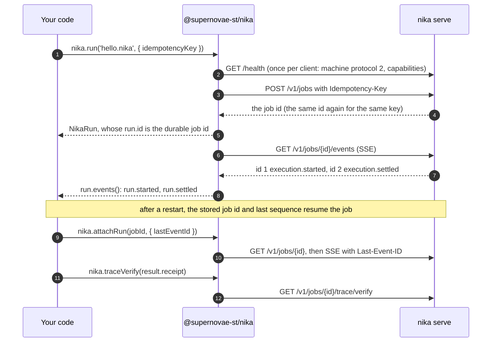

# Run on your server: `nika serve`

`nika serve --bind` is the same engine running as an HTTP server you operate.
It holds durable jobs and schedules, so a run outlives the process that
started it. Your code talks to it through the same `Nika` class and the same
methods; the constructor names the server, and a few options change (a run
needs an `idempotencyKey` and takes no `maxCostUsd`). This page covers setup,
the job lifecycle, recovery, retries and schedules. The wire contract, route by
route, is [http-api.md](http-api.md).



## Set it up

In the project folder you need four things.

1. **A project file.** The server refuses to start without one (`nothing
   armed — this project has no nika.yaml`). A one-line `nika.yaml` is
   enough; the [project file reference](https://docs.nika.sh/sdk/project/nika-yaml)
   lists what else it can hold (a default cost ceiling, trace retention,
   armed beats):

   ```yaml
   nika: my-project
   ```

2. **A private token file.** The server refuses one that is not mode `0600`
   or not 32–512 visible ASCII bytes:

   ```sh
   mkdir -p .nika
   (umask 077 && openssl rand -hex 24 > .nika/serve.token)
   chmod 600 .nika/serve.token
   ```

3. **A `.gitignore` entry for `.nika/`.** It holds your traces, the server's
   job state (`.nika/serve/`) and the token file. Never commit the token.

   ```sh
   printf '.nika/\n' >> .gitignore
   ```

4. **The server**, serving the workflows under the current folder:

   ```sh
   ./node_modules/.bin/nika serve \
     --bind 127.0.0.1:8787 \
     --workflows . \
     --token-file .nika/serve.token \
     --state-root .nika/serve
   ```

Then connect from Node:

```ts
import { readFile } from 'node:fs/promises';
import { Nika } from '@supernovae-st/nika';

const token = (await readFile('.nika/serve.token', 'utf8')).trim();
const nika = new Nika({
  url: 'http://127.0.0.1:8787',
  token,
  allowInsecureHttp: true, // plain HTTP, accepted only to a loopback host
});

const report = await nika.check('hello.nika');
const run = await nika.run('hello.nika', {
  idempotencyKey: 'hello-2026-10-24', // store it before the call; reuse it on retry
});
for await (const event of run.events()) {
  console.log(event.sequence, event.kind, event.status);
}
const result = await run.result();
console.log(report.clean, result.status);
```

```text
1 run.started running
2 run.settled succeeded
true succeeded
```

After `new Nika(...)`, the methods are the same as for a local engine; some
options are not. `run()` needs an `idempotencyKey` ([Retries without
duplicates](#retries-without-duplicates)) and takes no `maxCostUsd`
([What a server run does not take](#what-a-server-run-does-not-take)).

- **Workflows by name.** `hello.nika` or `daily/report.nika` is a name the
  server resolves in its `--workflows` folder: `check()` and `run()` send the
  name, so your app needs no local engine and no local file.
  `listWorkflows()` lists the names; `workflow(name)` describes one.
- **Your local file instead.** Pass an explicit path such as `./hello.nika`:
  the local engine captures an immutable snapshot of the file, and the
  package sends its exact bytes and checks the server's acknowledgement. Only
  this needs a local engine (`bin`, `NIKA_BIN` or the platform package).
- **Events.** A server run yields `run.started` then `run.settled`, in the
  same words as a local run, but no per-task events. A job admitted with
  `inputs` first yields an `engine.event`: the server's `execution.queued`
  frame, sequence 1. `event.sequence` is the server's replay cursor.
- **Model keys.** The server reads provider keys from its own environment.
  Your app sends none, and a server run takes no per-run model.
- **Access pins.** `run()` and `check()` take `access` with a served name:
  the job takes that path, as `nika run --access` does on the server's
  machine (see [runs.md](runs.md#pin-the-access-path-access)).
- **Large results.** The default `machineBufferBytes`, 16 MiB, is the bound
  of the server's own job store, so every result the server settles reaches
  `run.result()` and `attachRun()` (see
  [runs.md](runs.md#large-results-machinebufferbytes)).

**Watch the setup and one job: a retry that does not run twice, and a wrong token.**

<p align="center">
  <picture>
    <source media="(prefers-reduced-motion: reduce)" srcset="https://raw.githubusercontent.com/supernovae-st/nika-client/HEAD/media/stills/sdk-remote.png">
    
  </picture>
</p>
<p align="center"><sub>The README's version of these steps, typed as written (it leaves <code>--state-root</code> at its default, <code>.nika/serve</code>, and sends the server to the background of the same terminal). The client lists and checks the served <code>hello.nika</code> by name, runs it with an idempotency key, receives two sequenced events, reads <code>verified · sealed</code>, gets the same job back for the same key and a typed 401 for a wrong token. The token is never printed. Recorded from <code>@supernovae-st/nika</code> 0.123.0 and <code>nika serve</code> 0.123.0 on loopback; the run is a <code>mock/echo</code> rehearsal.<br>▶ <a href="https://github.com/supernovae-st/nika-client/blob/main/media/videos/sdk-remote.mp4?raw=true">MP4</a> · <a href="https://github.com/supernovae-st/nika-client/blob/main/media/transcripts/sdk-remote.txt">transcript</a> · <a href="https://github.com/supernovae-st/nika-client/blob/main/scripts/media/scenes/sdk-remote/remote.mts">the client it runs</a></sub></p>

## Retries without duplicates

Over HTTP, `run()` needs an `idempotencyKey` you own. Store a unique key for
each business operation before you call. If the response is lost or times
out, retry the same request with the same key: you get the same job. A new
key can start a second job. A local run refuses the key. Keys cover the
server's whole `--state-root` and do not expire, so make them globally unique
and never reuse one for another workflow.

For a webhook, the sender's delivery id is a natural key: a retried delivery
then reuses the job instead of running twice. Verify the webhook's signature
over the raw body with the sender's library first (this package exports no
verifier), then pass the parsed payload as `inputs` (see
[runs.md](runs.md#pass-your-apps-data-inputs)).

## Recovery after a restart

A run handle belongs to its process and is not serializable. Store the
**job id** (`run.id`) and the last `event.sequence` you fully processed, then
pick the job back up without submitting it again:

```ts
const recovered = await nika.attachRun(saved.jobId, {
  lastEventId: saved.lastEventSequence,
});
for await (const event of recovered.events()) {
  await saveApplicationCheckpoint(recovered.id, event.sequence);
}
console.log(await recovered.result());
```

`attachRun` is the one way back in, and it returns a full `NikaRun`. Only a
server's job id is durable: a local `run.id` is a throwaway id of the SDK
process, appears in no journal, and `attachRun` refuses it. A cursor means
"fully processed", not merely "received": persist it in the same transaction
as the effect it records.

When observation loses the connection past its retry budget, the package
makes one last durable read. A finished job settles `run.result()` from the
server's record; a job still running rejects with
`NikaObservationInterrupted`, whose `lastSequence` is the `lastEventId` to
resume from. That error is about this client's view, not the run, which may
still be running. The engine's own `interrupted` state is different: a server
that lost an execution reports a `run.interrupted` event and
`result.status === 'interrupted'`, as data.

[`examples/server-recovery.ts`](https://github.com/supernovae-st/nika-client/blob/main/examples/server-recovery.ts) does this
across two processes: `start` stores the key, submits, shows that a retry
returns the same job and exits after the first event; `resume` reattaches
from the saved cursor and verifies the job's record.

## Cancel a running job: the 5-second grace

`run.cancel()` on a running job answers 202:
`{ accepted: true, status: 'cancellation_requested' }`, the one request every
later `cancel()` on that handle returns. The server signals the run and waits
a **fixed 5 seconds**, which no option changes, for it to reach its next wave
boundary and settle. What the client sees depends on that grace:

| The run | Events end with | `result.status` | `result.settlement` |
|---|---|---|---|
| reaches a wave boundary within 5 s | `run.settled` | `cancelled` (cause `operator`), or `succeeded`/`failed` if that raced the request | present |
| is still inside a task 5 s later (a `nika:wait`, a model call, a command) | `run.interrupted` | `interrupted`, never `cancelled` | absent: the server dropped the execution, so its task tally and spend are unknown |

`run.status()` then reads the same word, and a `cancel()` from another handle
(after `attachRun`) answers `accepted: false`, `status: 'already_settled'`. A
job cancelled while still queued settles on the reply itself (200,
`status: 'cancelled'`). Measured on engine 0.123.1: a job inside a 20-second
`nika:wait` settled `interrupted` about 5 seconds after its cancel, with the
events `run.started` and `run.interrupted`. `run.interrupted` is the server's
word about the run; it is unrelated to `NikaObservationInterrupted`, which
means this client lost its view. A local engine has no such grace: it lets
work in flight settle, however long it takes (see
[runs.md](runs.md#cancel-a-run)).

**When the server restarts.** Ctrl-C or SIGTERM stops new admissions, then
drains running and queued jobs for up to 30 seconds. Past that grace, running
jobs become `interrupted` and queued jobs stay queued; a restart with the same
`--state-root` resumes the queued ones, and interrupted jobs are not retried.
A SIGKILL skips the drain: the next start marks ownerless running jobs
`interrupted`. (`nika serve --help` documents the same rules.)

## Connection rules

Plain HTTP is accepted only to a loopback host (`localhost`, `127.0.0.0/8`,
`[::1]`), and only with `allowInsecureHttp: true`; every other host needs
HTTPS, so the token never leaves the machine in plaintext. The URL may not
carry credentials, a query or a fragment, and the token must be 32–512 visible
ASCII bytes. To serve other machines, start the server with `--allow-remote`
behind a reverse proxy that terminates TLS (the server does not), and connect
with `https://`.

## What a server run does not take

`inputs` work by served name when the server advertises `jobInputs` (see
[runs.md](runs.md#pass-your-apps-data-inputs)), and so does `access`, which
every 0.123 server reads (see
[runs.md](runs.md#pin-the-access-path-access)). A local file's snapshot takes
neither: the package refuses them beside one (`snapshotInputs`,
`snapshotAccess`). There is no per-run `model`, `vars` or `maxCostUsd` over
HTTP: the package refuses them with a typed error instead of dropping them.
The server applies its own per-run ceiling to manual jobs
(`nika serve --run-cost-ceiling`, 1 USD by default; `none` turns it off).
Bound a server run through its workflow too: its model and `max_tokens`. A
server `check()` refuses `model` and `nativeStrict` the same way; its
`access` is acknowledged, not judged, since the server's check evaluates no
access plan (an empty pin is refused, `NIKA-1802`).

## Schedules

A schedule belongs to a server. A local client refuses `schedule` and
`scheduleStatus`, because a short-lived process cannot own schedule state.

```ts
const applied = await nika.schedule('hello.nika', {
  id: 'weekday-hello',
  when: { kind: 'cadence', expression: 'TZ=Europe/Paris 0 9 * * 1-5' },
  maxCostUsd: 0.01,
  missed: 'catch-up-once',
  overlap: 'skip',
  afterSkip: 'next_slot',
});

const status = await nika.scheduleStatus('weekday-hello');
console.log(applied.changed, status.next, status.lastDecision);

// Pause it: send the whole declaration again, with the revision you read.
await nika.schedule('hello.nika', {
  id: 'weekday-hello',
  when: { kind: 'cadence', expression: 'TZ=Europe/Paris 0 9 * * 1-5' },
  maxCostUsd: 0.01,
  missed: 'catch-up-once',
  overlap: 'skip',
  afterSkip: 'next_slot',
  revision: status.revision,
  active: false,
  pauseReason: 'maintenance',
  pauseUntil: '2026-12-01',
});
```

- **Revisions.** A create is sent with `If-None-Match: *`; an update needs
  the exact prior revision (`If-Match`). Revisions are the engine's opaque
  `sha256:<64 lowercase hex>` values: never make one up. A writer holding a
  stale revision gets a typed `NikaOperationError` with HTTP `status` 412,
  `code: 'schedule_conflict'` (the package's name for it), `machineCode:
  'schedule_precondition_failed'` (the server's own code) and
  `currentRevision`: the revision to retry from beside a stale `If-Match`,
  `null` when the server names none (a missing or malformed precondition).
- **Expressions.** A cron expression carries its time zone:
  `TZ=<IANA zone> …`. `tolerance` uses `m/k`. Timed hash jitter is not
  supported and is refused.
- **Pausing.** `active: false` needs a `pauseReason` and a `pauseUntil`
  calendar date (`YYYY-MM-DD`).
- **Overlap.** `afterSkip` needs `overlap: "skip"`, the engine's default, so
  leaving `overlap` out works too.
- **Budget.** A schedule's `maxCostUsd` must be a positive number: `0` is
  refused, where a local `run()` accepts it.
- **Older state.** Treat any `status.finding` recovered from older state as
  not runnable. The engine refuses a new active declaration it cannot plan
  before storing it. The planning facts in a status are the engine's, and new
  ones may appear.
- **A catch-up's receipt.** After the server was down, a `catch-up-once`
  run's `receipt.origin` names the silence it answers for: `missed_first`,
  the first slot that passed unfired, and `missed_count`, how many slots it
  holds; its `scheduled_for` is the last one.

**No server?** The CLI can hand a project's armed beats to your operating
system's scheduler instead: `./node_modules/.bin/nika arm --emit launchd
--write` on macOS, `--emit systemd` on Linux. A unit started by the OS does
not see the keys you export in your shell, so pass them with
`--env-file <file>`. See
[OS schedulers](https://docs.nika.sh/sdk/operations/os-schedulers) and the
[known limits](https://docs.nika.sh/changelog/known-limits).

## Local engine or server: what differs

| Operation | Local engine | `nika serve` |
|---|---|---|
| `check` | yes; `model` and `nativeStrict` allowed | yes; those two refused |
| `check` `access` | `--access=<pin>`; the report judges the access plan (`verdicts`) | by served name; acknowledged, not judged; an empty pin refused |
| `run` | yes; `model` and `maxCostUsd` allowed | yes; `idempotencyKey` required; `model` and `maxCostUsd` refused |
| `run` `access` | `--access=<pin>`; a pin the engine refuses settles the run `failed`, cause `refused` | by served name (`JobByName.access`); a pin the execution refuses settles the job `failed`; an empty pin refused at admission (422); a snapshot refuses it |
| `run` `inputs` | literal JSON over stdin; the engine must advertise `inputsLiteral` | literal JSON by served name; the server must advertise `jobInputs`; a snapshot refuses them |
| `run` `vars` (deprecated) | the `--var` operator channel, unchanged | refused |
| `attachRun` | refused: a local run belongs to its process | reattaches to a durable job, from an optional event cursor |
| `run.status()` | refused; await `run.result()` | the durable status |
| `run.events()` | lifecycle words over the engine's task and run frames | the same words over sequenced SSE with bounded replay; no per-task events |
| `run.cancel()` | signals the process; idempotent; in-flight work settles, however long | 200 settles the job; 202 accepts the request, and `run.result()` settles on the server's ending: `interrupted` once the fixed 5-second grace expires |
| `run.id` | a throwaway correlation id, never durable | the server's durable job id: the one to store |
| `traceVerify` | the engine's verifier plus the signed receipt binding | the server's verdict on the journal it wrote (`ok`, `sealed`…), or `unavailable` without one |
| `schedule` / `scheduleStatus` | refused | the server's schedules |
| `listWorkflows` / `workflow` | refused | the served workflow catalog, without paths |
| `compile` | the engine's `compile` capability; `authoringModel`, `decisionModel`, `fresh` and `output` allowed | `POST /v1/compile`, when advertised; `cognition` and `replay_token` need `compileNativeV2` |

The vocabulary is one; the number of events is not. A local engine reports
each task, a server reports durable, sequenced execution frames, and the
package names only what a transport actually sent. Do not assume the same
count on both. The frames under `event.raw` stay deliberately open.
